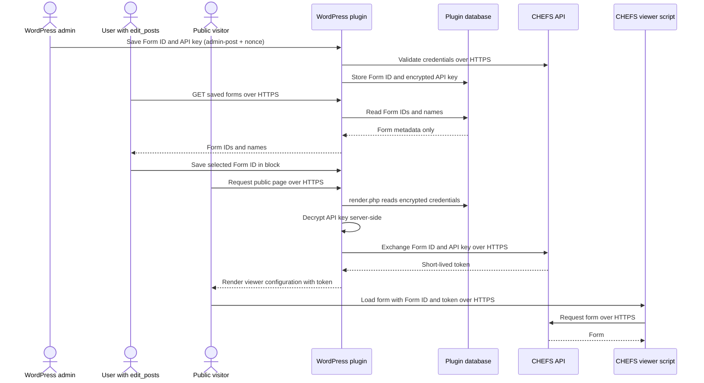

# Block architecture

The block metadata is defined in `src/chefs-form/block.json`. Its registered name is `bcew-chefs-embed/chefs-form`, its category is `widgets`, and its editor icon is the WordPress `media-document` Dashicon.

The block has one persisted attribute:

```json
{
	"formId": {
		"type": "string",
		"default": ""
	}
}
```

The API key and runtime token are never block attributes.

## Data flow

The runtime path below shows the target server-rendered token flow from
DSWP-1232. The browser receives a short-lived token so the CHEFS viewer can
load the form, but it never receives the stored API key.



Administrators manage Form IDs and API keys through nonce-protected
`admin-post` actions. Users with `edit_posts` can retrieve saved Form IDs and
select one in the block editor. Public visitors can load the published form
with the short-lived token produced during server rendering, but the API key
remains encrypted at rest and is only decrypted inside WordPress for the
server-to-server CHEFS token exchange.

## Editor flow

1. `src/chefs-form/edit.js` requests the saved forms from the `forms` REST route.
2. The stored CHEFS titles are displayed in the block sidebar.
3. Selecting a title updates the persisted `formId` attribute with the UUID.
4. If the selected Form ID is deleted by an administrator, the editor clears the stale selection.
5. The editor preview uses the runtime configuration endpoint and CHEFS viewer used by the published block.

The editor preview is provided by `src/chefs-form/components/chefs-form-preview.js`. It uses the same runtime configuration endpoint as the published block and loads the CHEFS viewer through `src/chefs-form/utils/ensure-chefs-form-viewer.js`.

## Frontend flow

`src/chefs-form/render.php` sanitizes the Form ID and renders the block wrapper with a `data-form-id` attribute. It renders an empty-state message when no Form ID is selected. It does not render an API key or token.

`src/chefs-form/view.js` runs in the browser after the page loads. For each block, it:

1. Finds the block wrapper and reads the Form ID from its `data-form-id` attribute.
2. Requests `/wp-json/bcew-chefs-embed/v1/embed-config?formId=<form-id>`. This request goes to WordPress, where the plugin retrieves the encrypted API key and exchanges it with CHEFS for a short-lived access token. The API key is never sent to the browser.
3. Loads the CHEFS form viewer web component from the CHEFS service if it is not already available on the page.
4. Creates the viewer inside the block's mount element and passes it the short-lived token and CHEFS base URL returned by WordPress. The visitor can then interact with the live form.
5. Listens for the viewer's `formio:submitDone` event. When submission succeeds, it removes the viewer and displays the configured confirmation message, or the generic success message when no custom message is configured.
6. Listens for the viewer's `formio:error` event. When CHEFS reports a submission error, it displays the error above the form and keeps the form available so the visitor can try again.

If the configuration request or viewer script fails before the form loads, the block displays a load error in place of the form.
