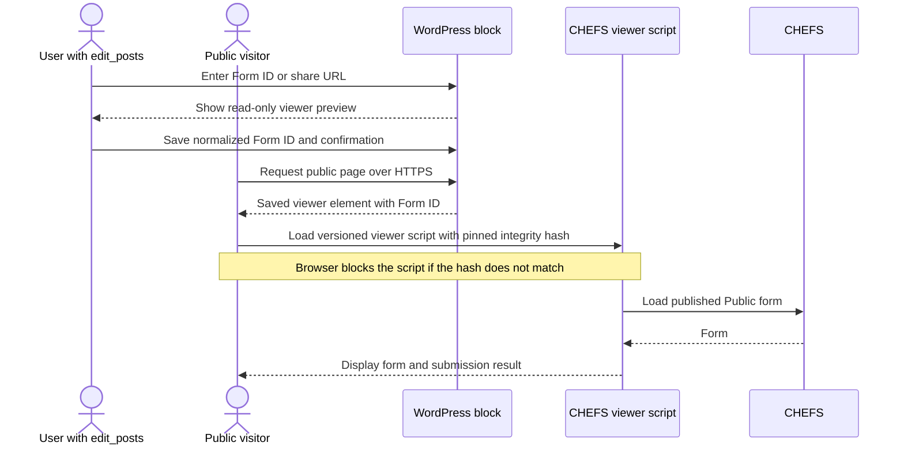

# Block architecture

The block metadata is defined in `src/chefs-form/block.json`. Its registered name is `bcew-chefs-embed/chefs-form`, its category is `widgets`, and its editor icon is the WordPress `media-document` Dashicon.

The block persists these attributes:

```json
{
	"formId": {
		"type": "string",
		"default": ""
	},
	"confirmationMessage": {
		"type": "string",
		"default": ""
	}
}
```

The editor accepts a Form ID or a CHEFS share URL and stores the normalized Form ID. The confirmation message is plain text.

## Data flow

The block saves the CHEFS viewer element and its public Form ID in the post
content. The browser loads the versioned viewer script with a Subresource
Integrity (SRI) hash pinned in the plugin, and the viewer then loads the
published Public form.



## Editor flow

1. `src/chefs-form/edit.js` accepts a Form ID or share URL, extracts the `f` value when present, and normalizes a valid UUID to lowercase.
2. The normalized Form ID is saved as the `formId` block attribute. Invalid input is reported without replacing a previously saved Form ID.
3. The optional plain-text confirmation is saved as `confirmationMessage`.
4. `src/chefs-form/components/chefs-form-preview.js` loads the CHEFS viewer in read-only mode for the editor preview.

`src/chefs-form/utils/ensure-chefs-form-viewer.js` loads the versioned viewer script once for the configured CHEFS base URL, with Subresource Integrity (SRI). See [Viewer script integrity](#viewer-script-integrity).

## Frontend flow

`src/chefs-form/save.js` saves the block wrapper and, when a Form ID is set, a `chefs-form-viewer` element with the Form ID and CHEFS base URL. It also saves the optional confirmation message on the wrapper.

`src/chefs-form/view.js` runs in the browser after the page loads. For each block, it:

1. Loads the viewer script with SRI if the custom element is not already defined. If the script fails or does not match its hash, the block shows a load error.
2. Calls the viewer's `load()` method when available.
3. On `formio:submitDone`, replaces the viewer with the configured confirmation, or a generic success message when no custom confirmation is set.
4. On `formio:error` or a viewer load failure, displays an accessible error and keeps the viewer available when possible.

## Viewer script integrity

The CHEFS form viewer script (`chefs-form-viewer.min.js`) is loaded with
[Subresource Integrity (SRI)](https://developer.mozilla.org/en-US/docs/Web/Security/Subresource_Integrity)
by `src/chefs-form/utils/ensure-chefs-form-viewer.js`.

The hash is hardcoded as `CHEFS_EMBED_INTEGRITY` in
`src/chefs-form/utils/constants.js`. The loader builds the script URL from
`CHEFS_BASE_URL` and `CHEFS_EMBED_VERSION`, sets `integrity` to that hash, and
sets `crossorigin="anonymous"`. If the script does not match the hash, the
browser blocks it and the block shows its load error. The loader does not
fetch the hash from CHEFS, because the same host would serve a changed file
and a changed hash together.

The hash is for one exact URL: `{CHEFS_BASE_URL}/embed/{CHEFS_EMBED_VERSION}/embed/chefs-form-viewer.min.js`.
If the base URL or version changes, the hash must be recomputed or the script will be blocked.

SRI covers only `chefs-form-viewer.min.js`. Assets the viewer loads itself
(Form.io scripts, styles, and fonts) are not covered.

### Updating the pinned hash

1. Download the script for the exact URL above and compute its hash:

   ```bash
   curl -sSL "<url>" | openssl dgst -sha384 -binary | openssl base64 -A
   ```

2. Prefix the output with `sha384-` and set `CHEFS_EMBED_INTEGRITY` in `constants.js`.
3. Update the comment next to it with the URL and date, then run the E2E tests.

Do this whenever `CHEFS_EMBED_VERSION` changes, or when CHEFS republishes the file.
