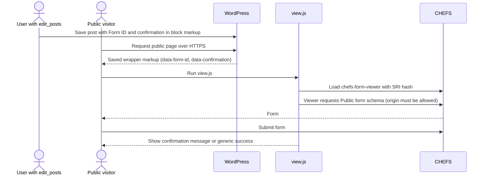

# Block architecture

The block metadata is defined in `src/chefs-form/block.json`. Its registered name is `bcew-chefs-embed/chefs-form`, its category is `widgets`, and its editor icon is the WordPress `media-document` Dashicon.

The block has the following attributes:

```json
{
	"formId": {
		"type": "string",
		"default": ""
	},
	"confirmationMessage": {
		"type": "string",
		"default": ""
	}
}
```

The editor accepts a Form ID or CHEFS share URL. `src/chefs-form/utils/normalize-form-id.js` validates the UUID, extracts it from the URL's `f` parameter, and stores the lowercase Form ID. The confirmation override is plain text.

## Saved markup

`src/chefs-form/save.js` stores the Form ID and confirmation override as `data-form-id` and `data-confirmation` on the block wrapper, with an empty `.bcew-chefs-form__mount` element.

The block does not use a PHP render callback or a WordPress REST route. The editor preview and published-page script create a `chefs-form-viewer` from the saved Form ID. `src/chefs-form/utils/ensure-chefs-form-viewer.js` loads the immutable CHEFS 1.1.0 viewer script with its Subresource Integrity hash.

## Data flow

The browser loads the form directly from CHEFS. WordPress only serves the saved markup; it never holds an API key or token.



## Anonymous embed requirements

CHEFS 1.1.0 supports embedding a Public form without an API key or token. The form must use the **Public** login option, and its **Allowed origins** must include the WordPress site's origin. Private forms and forms that do not allow the site's origin cannot load anonymously.

The CHEFS base URL is `https://submit.digital.gov.bc.ca/app`. Tests and local integration checks may use the DSWP-1364 PR deployment, `https://chefs-dev.apps.silver.devops.gov.bc.ca/pr-1966`, but that development URL must not be used in production configuration.

## Editor flow

1. `src/chefs-form/edit.js` presents a Form ID/share-URL field and a plain-text confirmation textarea.
2. The Form ID normalizer stores a valid UUID and rejects invalid input without persisting it.
3. `src/chefs-form/components/chefs-form-preview.js` loads the CHEFS viewer without a token and makes the form read-only in the editor.

## Frontend flow

1. WordPress serves the saved wrapper markup; no server-side API key lookup or token exchange is performed.
2. `src/chefs-form/view.js` finds each wrapper, reads its Form ID and confirmation override, loads the versioned viewer if necessary, and creates the viewer inside the mount.
3. The CHEFS viewer loads and submits the Public form anonymously, subject to the form's allowed-origin setting.
4. On `formio:submitDone`, the script replaces the viewer with the configured plain-text confirmation message, or generic success copy when the override is empty. On `formio:error`, it shows an accessible error and keeps the form available.

Credential-table and server-authentication cleanup are separate follow-up work in DSWP-1367 and DSWP-1370. The block no longer reads or renders those credentials.
