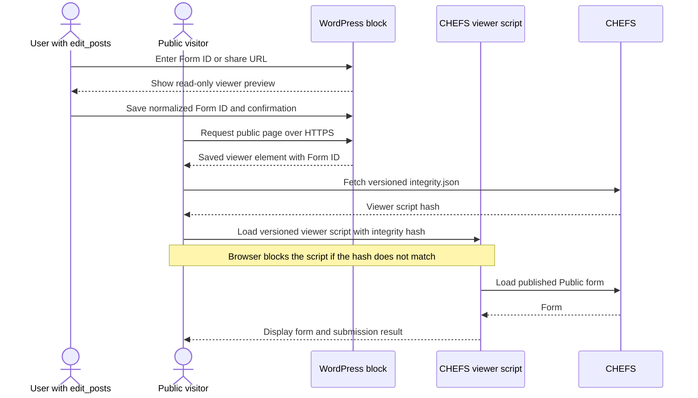

# Block architecture

The block metadata is defined in `src/chefs-form/block.json`. Its registered name is `bcew-chefs-embed/chefs-form`, its category is `widgets`, and its editor icon is the WordPress `media-document` Dashicon.

The block persists these attributes:

```json
{
	"formId": {
		"type": "string",
		"default": ""
	},
	"confirmationMessage": {
		"type": "string",
		"default": ""
	}
}
```

The editor accepts a Form ID or a CHEFS share URL and stores the normalized Form ID. The confirmation message is plain text.

## Data flow

The block saves the CHEFS viewer element and its public Form ID in the post
content. The browser reads the viewer script's hash from the versioned CHEFS
integrity manifest, loads the script with Subresource Integrity (SRI), and the
viewer then loads the published Public form.



## Editor flow

1. `src/chefs-form/edit.js` accepts a Form ID or share URL, extracts the `f` value when present, and normalizes a valid UUID to lowercase.
2. The normalized Form ID is saved as the `formId` block attribute. Invalid input is reported without replacing a previously saved Form ID.
3. The optional plain-text confirmation is saved as `confirmationMessage`.
4. `src/chefs-form/components/chefs-form-preview.js` loads the CHEFS viewer in read-only mode for the editor preview.

`src/chefs-form/utils/ensure-chefs-form-viewer.js` loads the versioned viewer script once for the configured CHEFS base URL, with Subresource Integrity (SRI). See [Viewer script integrity](#viewer-script-integrity).

## Frontend flow

`src/chefs-form/save.js` saves the block wrapper and, when a Form ID is set, a `chefs-form-viewer` element with the Form ID and CHEFS base URL. It also saves the optional confirmation message on the wrapper.

`src/chefs-form/view.js` runs in the browser after the page loads. For each block, it:

1. Loads the viewer script with SRI if the custom element is not already defined. If the integrity manifest or script fails, the block shows a load error.
2. Calls the viewer's `load()` method when available.
3. On `formio:submitDone`, replaces the viewer with the configured confirmation, or a generic success message when no custom confirmation is set.
4. On `formio:error` or a viewer load failure, displays an accessible error and keeps the viewer available when possible.

## Viewer script integrity

The CHEFS form viewer script (`chefs-form-viewer.min.js`) is loaded with
[Subresource Integrity (SRI)](https://developer.mozilla.org/en-US/docs/Web/Security/Subresource_Integrity)
by `src/chefs-form/utils/ensure-chefs-form-viewer.js`.

CHEFS publishes an `integrity.json` manifest for each immutable embed version.
It maps each asset path, relative to the version root, to its SRI hash:

```json
{
	"embed/chefs-form-viewer.min.js": "sha384-..."
}
```

The loader:

1. Builds both URLs from the block's CHEFS base URL and `CHEFS_EMBED_VERSION`, for example `{base}/embed/1.1.0/integrity.json` and `{base}/embed/1.1.0/embed/chefs-form-viewer.min.js`.
2. Fetches the manifest without credentials and reads the hash stored under `embed/chefs-form-viewer.min.js`.
3. Injects the script with `integrity` set to that hash and `crossorigin="anonymous"`.

The script is not injected when the manifest is unavailable, the configured
version does not exist (the manifest returns `404`), or the hash is missing or
not a valid `sha256`/`sha384`/`sha512` value. If the script content does not
match the hash, the browser blocks it. In every case the block shows its
existing load error; no other handling is added.

Residual risk: the manifest is served from the same CHEFS origin as the
script, so SRI detects a changed or swapped script file but does not protect
against a full compromise of the CHEFS host that also changes the manifest.
SRI covers only `chefs-form-viewer.min.js`; assets that the viewer loads
itself (for example Form.io scripts, styles, and fonts) are not covered.

### Upgrading the CHEFS embed version

Set `CHEFS_EMBED_VERSION` in `src/chefs-form/utils/constants.js`. Before changing it, confirm CHEFS publishes `{base}/embed/<version>/integrity.json` with an `embed/chefs-form-viewer.min.js` entry. Then update the version asserted in `tests/e2e/chefs-form-frontend.spec.js`, rebuild, and run the E2E tests.
