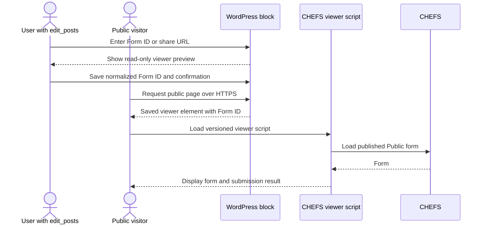

# Block architecture

The block metadata is defined in `src/chefs-form/block.json`. Its registered name is `bcew-chefs-embed/chefs-form`, its category is `widgets`, and its editor icon is the WordPress `media-document` Dashicon.

The block persists these attributes:

```json
{
	"formId": {
		"type": "string",
		"default": ""
	},
	"confirmationMessage": {
		"type": "string",
		"default": ""
	}
}
```

The editor accepts a Form ID or a CHEFS share URL and stores the normalized Form ID. The confirmation message is plain text. The block does not store credentials or tokens.

## Data flow

The block saves the CHEFS viewer element and its public Form ID in the post
content. The browser loads the versioned viewer script from CHEFS, which loads
the published Public form. WordPress does not store API keys, exchange tokens,
or expose CHEFS REST routes.



## Editor flow

1. `src/chefs-form/edit.js` accepts a Form ID or share URL, extracts the `f` value when present, and normalizes a valid UUID to lowercase.
2. The normalized Form ID is saved as the `formId` block attribute. Invalid input is reported without replacing a previously saved Form ID.
3. The optional plain-text confirmation is saved as `confirmationMessage`.
4. `src/chefs-form/components/chefs-form-preview.js` loads the CHEFS viewer in read-only mode for the editor preview.

`src/chefs-form/utils/ensure-chefs-form-viewer.js` loads the versioned viewer script once for the configured CHEFS base URL.

## Frontend flow

`src/chefs-form/save.js` saves the block wrapper and, when a Form ID is set, a `chefs-form-viewer` element with the Form ID and CHEFS base URL. It also saves the optional confirmation message on the wrapper. There is no `render.php` or server-side render callback.

`src/chefs-form/view.js` runs in the browser after the page loads. For each block, it:

1. Loads the viewer script if the custom element is not already defined.
2. Calls the viewer's `load()` method when available.
3. On `formio:submitDone`, replaces the viewer with the configured confirmation, or a generic success message when no custom confirmation is set.
4. On `formio:error` or a viewer load failure, displays an accessible error and keeps the viewer available when possible.

If no Form ID is set, the saved block contains no viewer element.
