# User docs

This guide explains how administrators and authorized users can upload, organize, search, and manage PDF documents and their metadata.

## Document Repository

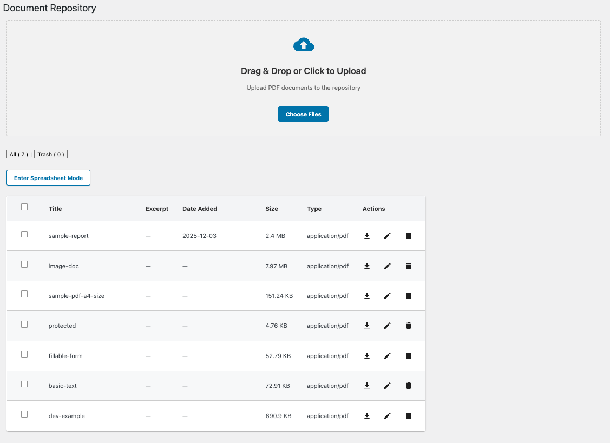

### Prerequisites and access

- Document Repository plugin installed and enabled.
- WordPress Search plugin installed and enabled to search document metadata.
- Admins or users with edit capability can upload, edit, and delete documents.

### Where to find it

In WordPress Admin: **Document Repository** (left navigation).

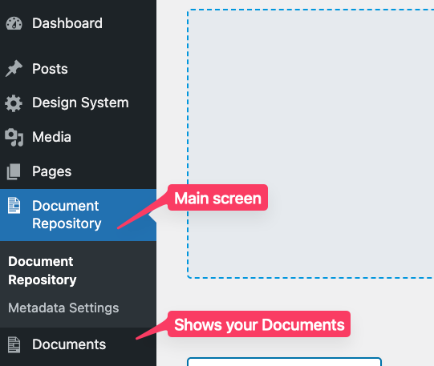

### What you can do

- Upload PDF documents.
- Organize documents with titles and excerpts.
- Add custom metadata fields defined in **Metadata Settings**.
- Search and filter by document content and metadata.
- Use standard list and spreadsheet views.

### Upload a document

1. Go to **Document Repository** in WordPress Admin.
2. Drag files into the **Drag & Drop** area, or click **Choose Files**.
3. Select PDF files and click **Open**.
4. Uploaded documents appear in the list.

Only valid PDF files are accepted.

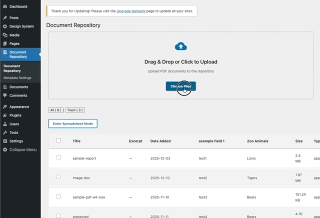

### Edit document metadata

1. Go to **Document Repository**.
2. Click the pencil icon to open the editor, or edit inline in **Spreadsheet Mode**.
3. Update the **Title**, **Excerpt**, and any **Metadata Fields**.
4. Click **Save Changes**.

Taxonomy fields may contain one or more values, separated by commas or Enter.

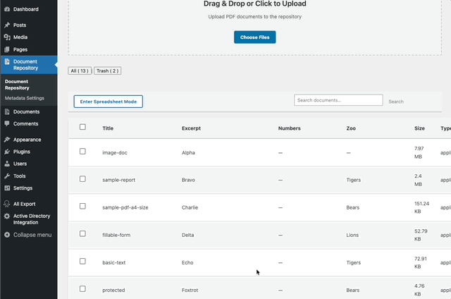

### Delete (trash) a document

1. Select documents and click **Trash Selected**, or click the **Trash** icon beside a document.
2. Review the confirmation and confirm, or cancel.

Trashed documents can be restored or permanently deleted from the **Trash** view. Permanent deletion removes the file and associated metadata.

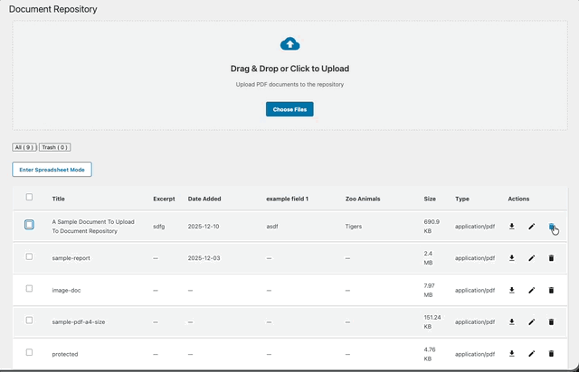

### Search documents

Use the **Search** box, enter a keyword, then press **Enter** or click **Search**. Search matches titles, excerpts, and metadata. Clear the input and search again, or click **X**, to reset.

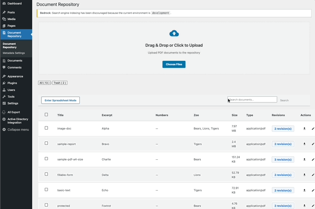

### View modes

Standard view shows titles, excerpts, configured metadata, file size and type, revisions, and actions. Spreadsheet view shows documents and metadata in columns and supports inline editing. Use the **View Mode** toggle in the top-right to switch.

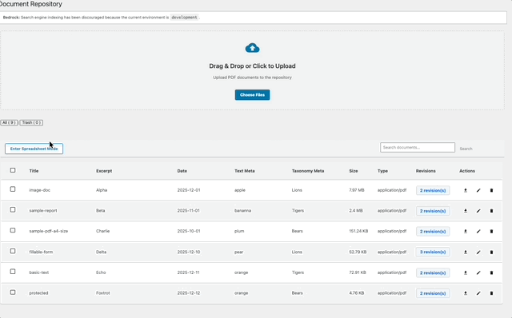

### Document revisions

1. Click **Revisions** for a document.
2. Use **Previous** and **Next** to navigate versions.
3. Click **Restore this Revision** to apply it; this opens the editor.
4. Optionally edit the revision text and save.

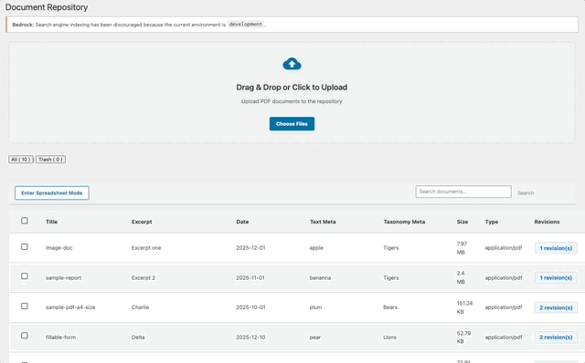

Documents can be **Published**, **Draft**, or **Pending Review**. To restore a trashed document, open **Trash**, select it, and click **Restore**.

### Tips and troubleshooting

- Use descriptive titles and excerpts; define metadata fields before large uploads.
- Confirm files are valid PDFs and within hosting size limits if upload fails.
- If search misses documents, ensure the WordPress Search plugin is active and has indexed metadata.
- If fields do not appear, create them in **Metadata Settings** and refresh.
- Verify user permissions if editing or deleting is unavailable.

## Metadata Settings

Metadata Settings defines custom fields displayed on documents and used for search, sorting, and filtering.

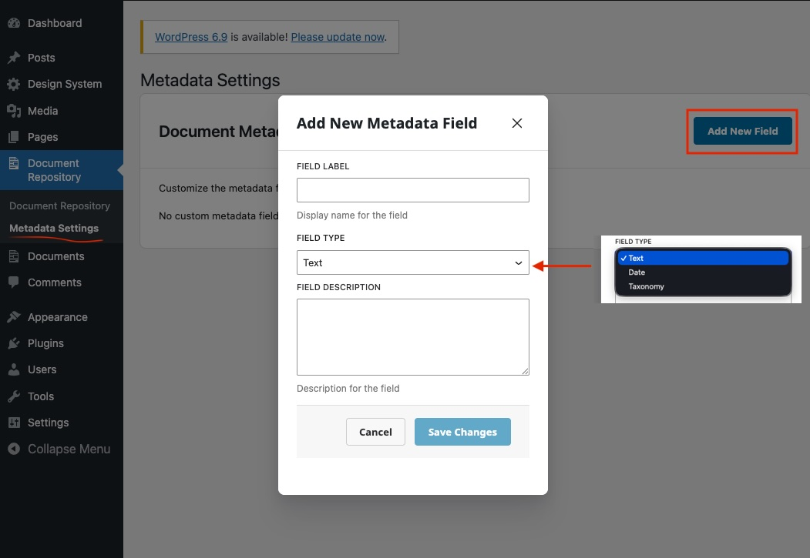

### Access and fields

In WordPress Admin, go to **Document Repository → Metadata Settings**. Admins or users with edit capability can manage fields.

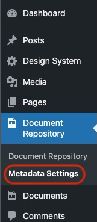

Each field has a required **Field Label**, a **Field Type** (`Text`, `Date`, or `Taxonomy`), and optional **Description**. Taxonomy fields require terms, one per line; for example, taxonomy Animals with terms Ape, Bear, and Coyote.

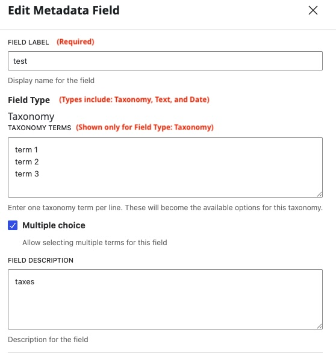

Field type cannot be changed after creation. Text and Date values may be empty; Taxonomy requires terms. New fields appear on documents with blank values until edited.

### Add a field

1. Go to **Document Repository → Metadata Settings** and click **Add New Field**.
2. Enter a label and choose Text, Date, or Taxonomy.
3. For Taxonomy, enter terms one per line and optionally enable **Multiple Choice**.
4. Optionally add a description, then click **Save**.

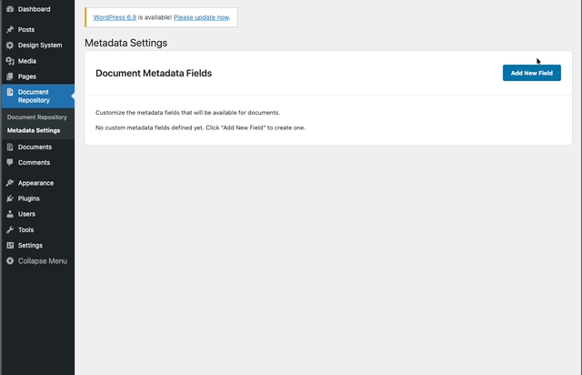

### Edit or delete a field

Click **Edit** beside a field to update its label, description, or taxonomy terms. Type is locked after creation. Keep at least one taxonomy term. Existing documents retain their prior values until edited.

Click **Delete** and confirm to permanently remove the field and all its values. The field disappears from both views.

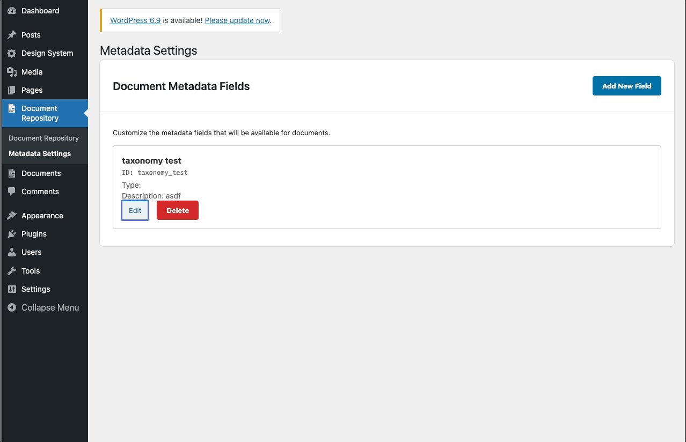
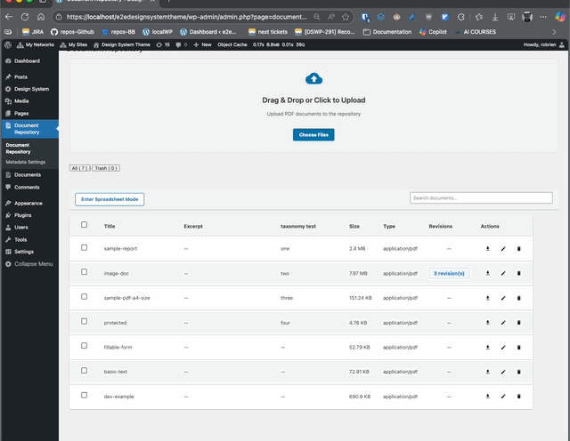

### Use metadata

Fields appear as columns in standard and spreadsheet views. Edit values per document in either view. Text, date, and taxonomy fields can be searched or filtered by matching text, date, or selected terms.

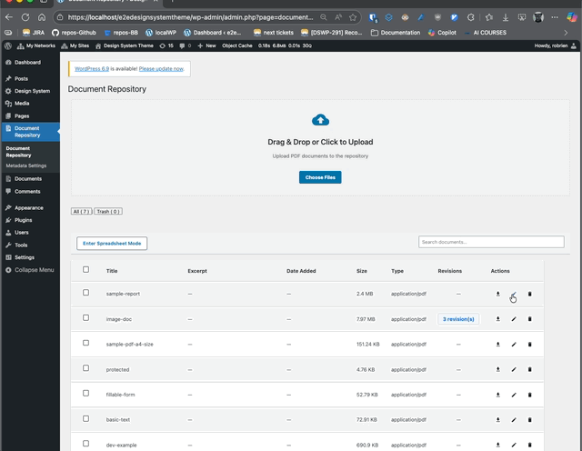

Create only fields you will use; plan taxonomy terms carefully. If fields are missing, refresh and confirm they exist and you have permission. New fields are blank until document values are edited. Field types are fixed; delete and recreate a field to change type. Keep the number of fields and taxonomy terms manageable for performance.
