# User docs

This guide covers existing Site Editor features for WordPress site authors and administrators.

Jump to:

- [Notification Banner](#notification-banner)
- [In-Page Navigation](#in-page-navigation)
- [Navigation Block](#navigation-block)
- [Content Security Policy (CSP)](#content-security-policy-csp)
- [BreadCrumb Block](#breadcrumb-block)

## Notification Banner

Use this tool to enable a Notification Banner at the top of each page of your website. You can choose the text shown in the banner, as well as its background color. HTML markup is also valid if you want to control the format of the text.

The tool lives in:

- WordPress Admin → Design System → Notification Banner

Click Save Settings to apply changes, and see a preview below the Banner Preview label.

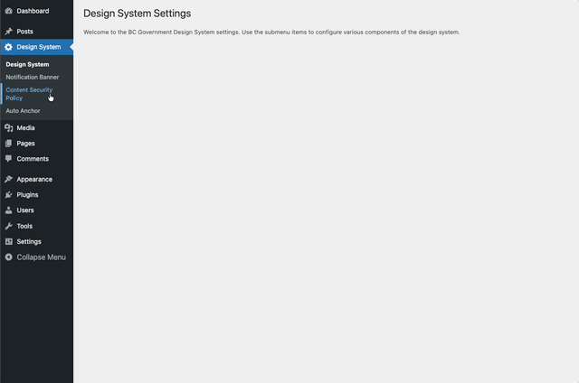

### How the banner tool works

- Enable/Disable the banner using the radio buttons.
- The Banner Content textbox can accept plain text or HTML Markup, such as:
        - <strong>strong (bold)</strong>
        - <em>emphasis (italics)</em>
        - <u>underline (use with caution; can confuse links)</u>
        - <s>Strikethrough</s>
        - <mark>Highlighted text</mark>
        - <pre>preformatted text (preserves spaces and line breaks)</pre>
- Other specialized text markup: `<abbr>`, `<code>`, `<kbd>`, `<var>`, ``, and ``.
- List item markup: `<ul>`, `<ol>`, `<li>`, `<dl>`, `<dt>`, and `<dd>`.
- Quotations and citations: `<blockquote>`, `<q>`, and `<cite>`.
- Headings: `<H1>` through `<H6>`.
- Choose the background banner color using the color-coded background status colors:
     Warning,
     Danger,
     Success, or
     Info.
- To hide the banner, simply click 'Disable' beside 'Enable Banner'.

### Notification Banner recipes

- Test Site Banner
    - Text: `This is the Dev/Test Environment. The content you are viewing is not final and subject to change.`
    - Background color: Danger
- Site under maintenance
    - Text: `This site is under maintenance. Please check back periodically for updates`
    - Background color: Warning
- Informational Banner
    - Text: `Here are instructions for filling in this form...`
    - Background color: Info

### Notification Banner testing

1. Save Settings.
2. Verify the banner preview matches expectations.
3. Navigate to your homepage and hard-refresh your browser.
4. Verify the text and background color of the banner are correct.

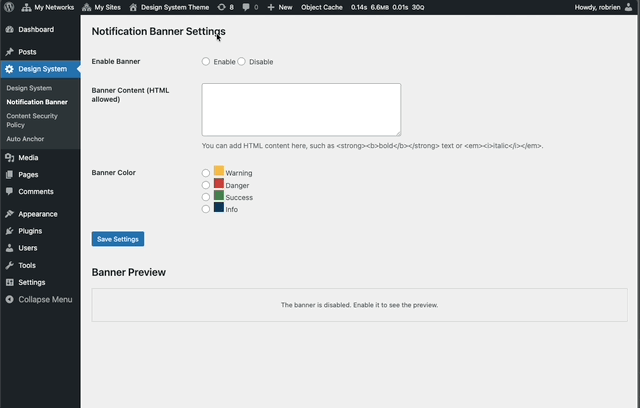

## In-Page Navigation

Provides an automatic table of contents for Pages by collecting all H2 headings and presenting numbered jump links.

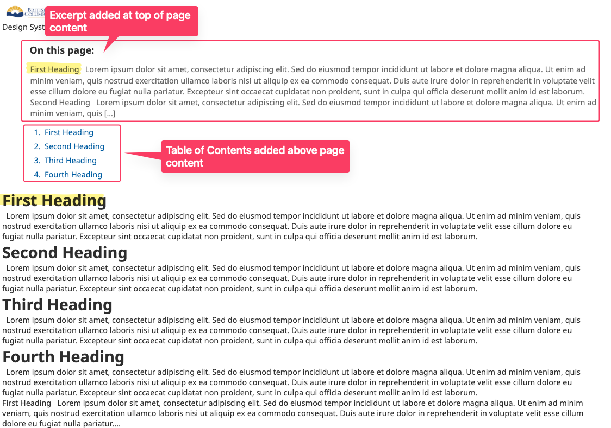

### When it appears

- Only on Page post type.
- Only if at least one H2 exists.
- Enabled per page via a toggle in the editor sidebar.

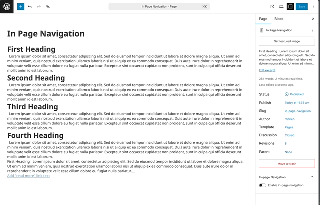

### In-Page Navigation behavior

- Renders an aside containing numbered links to each section.
- Shows the optional page excerpt at the top, if set.
- Highlights the active section while scrolling (mobile emphasis).
- Smooth scroll on link click.

### Editor usage

1. Edit a Page.
2. Open the “In-page Navigation” panel in the document settings.
3. Toggle “Enable in-page navigation” on.
4. Update the Page.

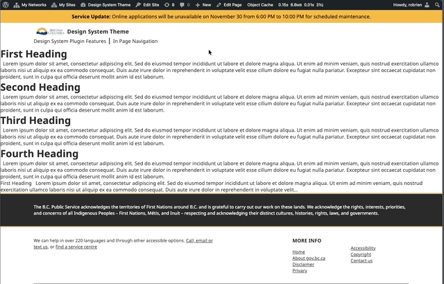

### Responsive behavior

- Desktop (>768px): Expanded list always visible.
- Mobile (≤768px): Sticky bar; toggle button collapses/expands; current section emphasized; background lightens after scroll.

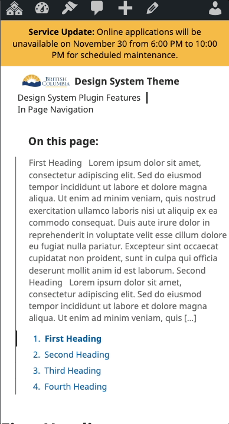

### Excerpt

If the Page has an excerpt, it is shown at the top of the navigation for context.

## Navigation Block

Add a site navigation menu to pages and posts. This block extends the WordPress core Navigation block with improved styling, submenu handling, and a mobile overlay menu.

Find it in:

- Block Inserter (+) → Design System → Navigation

After inserting the block, select a WordPress Menu in the block settings.

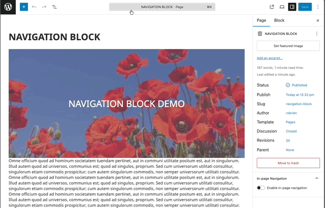

### Navigation Block behavior

- Uses your existing WordPress Menus:
    - Create or edit menus in WordPress Admin → Appearance → Menus.
    - In the block settings, choose which Menu to display.
- Enhanced styling for top-level items, nested submenus, editor preview, and mobile menu toggle.
- Responsive behavior:
    - Desktop: inline menu.
    - Mobile: optional full-screen overlay with a toggle.
    - Overlay behavior is controlled by Overlay Mode and the Mobile Breakpoint.

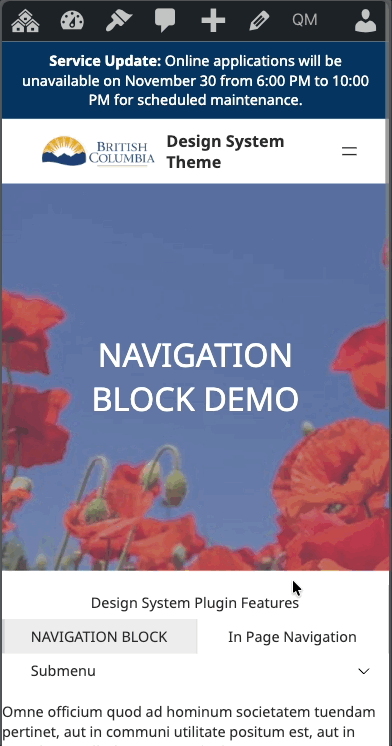

### Key settings

- Overlay Mode:
    - Always Overlay: Always show as an overlay with a toggle.
    - Mobile Overlay: Switch to overlay below the Mobile Breakpoint.
    - Never Overlay: Always show as a standard inline menu.
- Mobile Breakpoint:
    - Width at which Mobile Overlay activates (for Mobile Overlay mode).
    - Default: 768px.
    - Adjustable in the block settings.
- Visibility:
    - Show on Desktop: Visible at widths ≥ Mobile Breakpoint.
    - Show on Mobile: Visible at widths < Mobile Breakpoint.
    - If both are disabled, the menu still renders as a safety fallback to avoid hiding site navigation entirely.

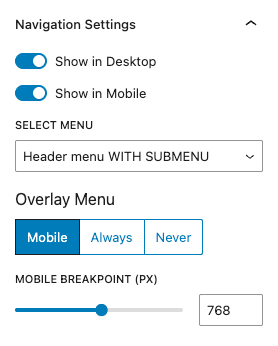

### Submenus

- Desktop: Open on hover; close when the pointer leaves the submenu area.
- Mobile: Open/close via the arrow toggle next to the parent item.
- Nested submenus are positioned to remain within the viewport.
- Behavior mirrors the core Navigation block for keyboard and screen-reader support.

### Usage tips

- Keep mobile labels concise to prevent wrapping in the overlay.
- Manage structure in Appearance → Menus; items are not added in the block editor.
- Test across breakpoints to confirm overlay and visibility match expectations.

### Navigation Block testing

1. Add the Navigation block to a page or post.
2. In the settings panel, select a WordPress Menu.
3. Configure Overlay Mode, Mobile Breakpoint, and Visibility.
4. View the page and resize:
   - Above the breakpoint: confirm desktop menu and hover submenus.
   - Below the breakpoint: confirm mobile toggle, overlay, and tap-to-open submenus.
5. Confirm the current page is highlighted in the menu.

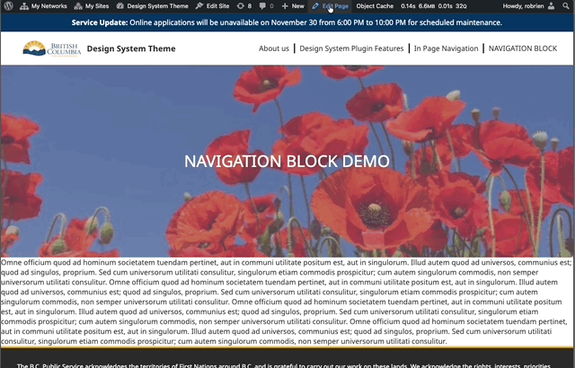

### Navigation Block troubleshooting

- No menu appears:
    - Ensure a Menu is selected in the block settings.
    - Verify the selected Menu has items in Appearance → Menus.
- Overlay toggle not visible on mobile:
    - Set Overlay Mode to Mobile Overlay or Always Overlay.
    - Ensure Show on Mobile is enabled and the breakpoint is appropriate.
- Can’t hide the menu entirely: both visibility toggles off still render the block as a safety fallback.

## Content Security Policy (CSP)

Use this tool to control which sources your WordPress site can load for scripts, styles, images, fonts, media, XHR/WebSocket connections, and frames. Tight CSP rules improve security and reduce the risk of cross-site scripting (XSS).

The tool lives in:

- WordPress Admin → Design System → Content Security Policy

Click Save Settings to apply changes.

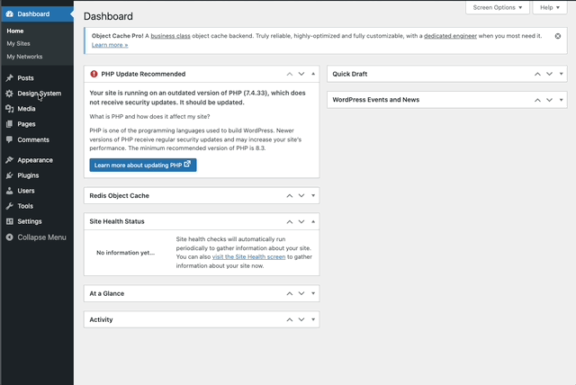

### How the form works

- Each field accepts a space-separated allowlist of sources (no commas).
- If a field is left empty, the plugin uses its built-in defaults (shown as helper text under each label).
- You can add:
    - Keywords: `'self'` `'none'` `'unsafe-inline'` `'unsafe-eval'` `data:` `blob:` `https:`
    - Hosts: `example.com` `sub.example.com`
    - Wildcards: `*.example.com`
- Use the least-privilege set you can. Prefer HTTPS. Avoid `'unsafe-inline'` and `'unsafe-eval'` when possible.

To revert a directive to defaults, clear the field and Save Settings. To block a type entirely, enter `'none'`.

### Directive reference

The defaults shown in the UI include the design system’s domains (e.g., gov.bc.ca, twimg.com, flickr domains, and YouTube for embeds).

#### Default-src Policy

- Fallback for all resource types without an explicit directive.
- Keep minimal. Add broad hosts here only if you can’t scope them to a more specific directive.
- Example additions: `https: cdn.example.com`

#### Script-src Policy

- JavaScript files and inline JS.
- Prefer hosted files over inline scripts. Remove 'unsafe-inline'/'unsafe-eval' if your site doesn’t require them.
- Example additions: `cdn.jsdelivr.net cdn.skypack.dev www.googletagmanager.com www.google-analytics.com`

#### Style-src Policy

- CSS files and inline styles.
- If you must allow inline styles, keep 'unsafe-inline'. Consider using hashed inline styles instead of broad allowance.
- Example additions: `fonts.googleapis.com cdn.jsdelivr.net`

#### Connect-src Policy

- Fetch/XHR, WebSocket, EventSource, analytics beacons, and GraphQL endpoints.
- Example additions: `api.example.com *.sentry.io`

#### Img-src Policy

- Images and favicons. data: allows inline base64 images.
- Example additions: `i.ytimg.com cdn.example.com data:`

#### Font-src Policy

- Font files (woff, woff2, ttf). data: enables embedded fonts like `data:font/woff2;base64,d09GMgABAAAAAA...')`
- Example additions: `fonts.gstatic.com data:`

#### Media-src Policy

- Audio and video files (not iframes).
- Example additions: `media.example.com`

#### Frame-src Policy

- Origins allowed in iframes (and workers for some browsers).
- Example additions: `*.youtube.com youtu.be *.vimeo.com *.rumble.com`

### CSP recipes

- Google Fonts
    - style-src: `fonts.googleapis.com`
    - font-src: `fonts.gstatic.com data:`
- YouTube/Vimeo embeds
    - frame-src: `*.youtube.com youtu.be *.vimeo.com`
    - img-src: `i.ytimg.com` (for thumbnails)
- Mapbox
    - script-src: `api.mapbox.com`
    - style-src: `api.mapbox.com`
    - img-src: `api.mapbox.com`
    - connect-src: `events.mapbox.com`
- Generic CDN
    - Add the CDN host to the specific directive you need (script-src, style-src, img-src, etc.), e.g., `cdn.example.com`.

### CSP testing

1. Save Settings.
2. Hard-refresh the page in your browser (Shift+Reload).
3. Open DevTools → Console. Look for “Refused to connect/script/style from … because it violates the Content Security Policy”.
4. Add the blocked origin to the correct directive and save again.
5. Repeat until violations are gone.

If something still doesn’t load, verify the exact hostname in the violation message and add that host (or a wildcard like `*.example.com`) to the correct directive.

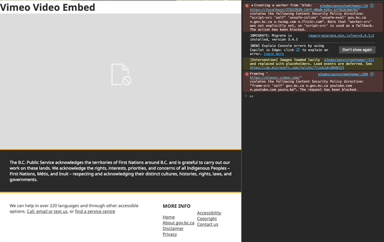

### CSP FAQ

- How do I reset to defaults?
    - Clear the field and click Save Settings.
- Can I disable a resource type completely?
    - Enter 'none' in that directive and save.
- Do I need commas?
    - No. Use spaces between entries.

## BreadCrumb Block

The BreadCrumb Block outputs a trail representing the current view (for example, Home / Parent / Child). It is especially useful for large sites with nested pages.

### When to use

Place the block near the top of templates or in a Header/Content template part to improve navigation clarity and orientation.

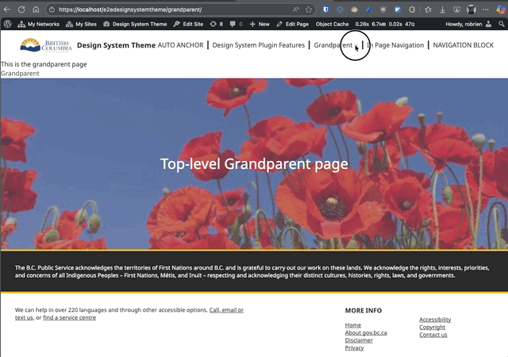

### Editing experience

In the Site Editor or content editor, the block shows the static example Home / Parent / Child. The current context and hierarchy appear only on the front end. The block has no breadcrumb-specific settings.

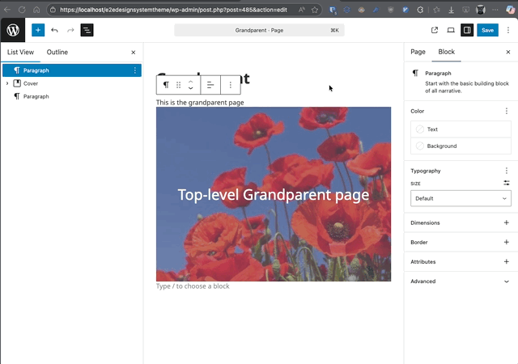

### Front-end behavior

For singular hierarchical content, the trail contains Home, intermediate ancestors, and the current item as plain text. For non-hierarchical singular content, the posts index, search results, archives, and 404 pages, it shows Home followed by the current context. Home and ancestors are links; the current item is not linked. The breadcrumb is not displayed on the front page.

### Usage examples

#### Add to a template

1. Appearance > Editor.
2. Open the relevant template or create a Template Part such as Header.
3. Insert “BreadCrumb” block below site header.
4. Save and view the template on the front end.

#### Quick demo hierarchy

Create three Pages:

- Grandparent (top level)
- Parent (set Parent to Grandparent)
- Child (set Parent to Parent)

View the Child page with the block placed in the Page template.

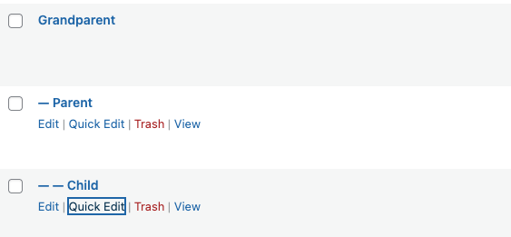

### Accessibility

- Uses a navigation landmark with an accessible label.
- Each ancestor is a link; the current item is plain text.
- Keep link text concise; page title changes automatically propagate.

### Best practices

- Avoid placing multiple breadcrumb blocks on the same template.
- Keep divider style consistent site-wide.
- Do not manually duplicate breadcrumb links in body content.

### Breadcrumb troubleshooting

- Breadcrumbs missing: Confirm the block is present in the template used by the current view.
- Wrong hierarchy: Verify parent settings for each Page.
- Breadcrumb absent on the front page: This is expected behavior.

Archives show the current archive title but not a taxonomy ancestor path.
