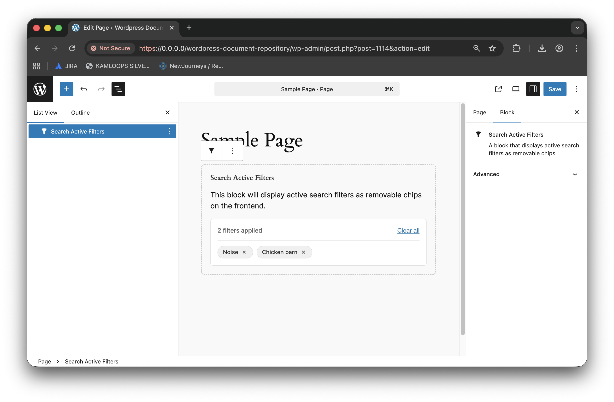

# Search Active Filters Block

Displays currently applied filters and allows users to clear them.

## Features

- Shows all active filters as tags
- Remove individual filters or clear all
- Responsive layout

## Settings

- No user-configurable settings

## Usage

1. Add the Search Active Filters block above your search results.
2. The block automatically displays applied filters and allows users to remove them.

## Related Blocks

- Search
- Search Post Filter
- Search Taxonomy Filter
