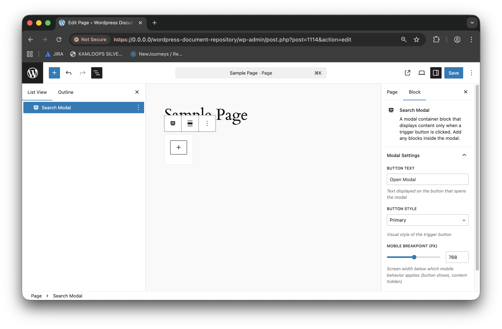

# Search Modal Block

Provides a modal overlay for search, allowing nested blocks inside.

## Features

- Modal overlay for search interface
- Supports InnerBlocks (add any blocks inside the modal)
- Keyboard accessible

## Settings

- No user-configurable settings

## Usage

1. Add the Search Modal block to your page.
2. Add other blocks (e.g., Search, Filters, Results) inside the modal.
3. Modal opens/closes via trigger button.

## Related Blocks

- Search
- Search Post Filter
- Search Taxonomy Filter
- Search Results Post Metadata Display
