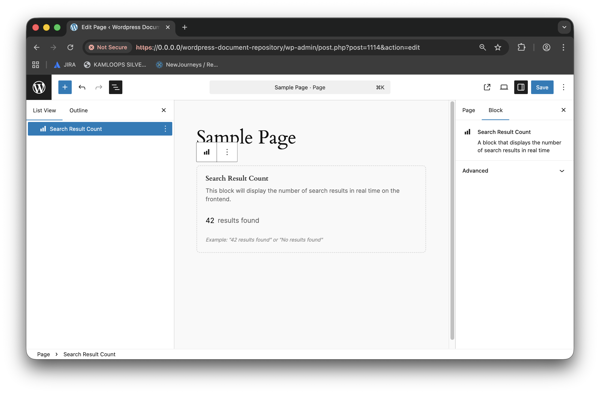

# Search Result Count Block

Displays the total number of search results.

## Features

- Shows dynamic result count as filters change
- Responsive design

## Settings

- No user-configurable settings

## Usage

1. Add the Search Result Count block above your search results.
2. The block automatically counts and displays results.

## Related Blocks

- Search
- Search Active Filters
